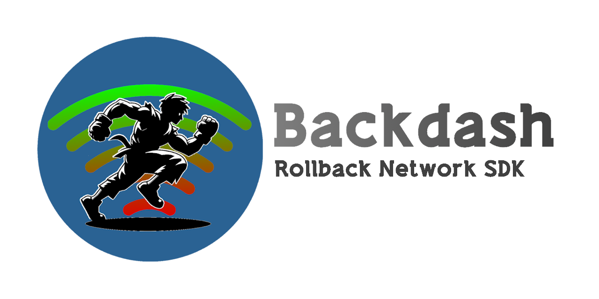

[](https://www.nuget.org/packages/Backdash)
[](#)
[](#)

[](https://github.com/Delta3-Studio/Backdash/actions/workflows/ci.yml)
[](#)
[](#)

# Backdash 🕹️

[](https://github.com/Delta3-Studio/Backdash)

Highly configurable and extensible implementation
of [Rollback Netcode](https://en.wikipedia.org/wiki/Netcode#Rollback) with full asynchronous IO.

> **Heavily** inspired by [GGPO](https://github.com/pond3r/ggpo).

## Overview

Traditional techniques account for network transmission time by adding delay to a players' input, resulting in a
sluggish, laggy game-feel. Rollback networking uses input prediction and speculative execution to send player inputs to
the game immediately, providing the illusion of a zero-latency network. Using rollback, the same timings, reactions,
visual and audio queues, and muscle memory your players build up playing offline will translate directly
online. [Backdash](https://github.com/Delta3-Studio/Backdash) is designed to make incorporating rollback networking
(_aka.
Rollback [Netcode](https://words.infil.net/w02-netcode.html)_) into new and existing games as easy as possible.

## Getting started

[NuGet package](https://www.nuget.org/packages/Backdash) available:

```ps
$ dotnet add package Backdash
```

> [!TIP]
> 💡 Please check the **[DOCUMENTATION](https://delta3-studio.github.io/Backdash/docs/introduction)** for samples, demos and usage details.

## Building from source

You need to have installed [.NET 10 SDK](https://dotnet.microsoft.com/en-us/download)


1. Clone this repository.
2. Restore tools
    - On the root directory run: `dotnet tool restore`
3. Building Library (_root directory_)
    - SDK only: `dotnet nuke build --configuration Release`
        - Alternatively, open the solution file `Backdash.slnx` on your IDE.
    - SDK and samples `dotnet nuke build-samples --configuration Release`.
        - Alternatively, open the solution file `Samples/Backdash.Samples.slnx` on your IDE.

## Licensing

[Backdash](https://github.com/Delta3-Studio/Backdash) is available under The MIT License. This
means [Backdash](https://github.com/Delta3-Studio/Backdash) is free for commercial and non-commercial use.

Attribution is not required but appreciated.
